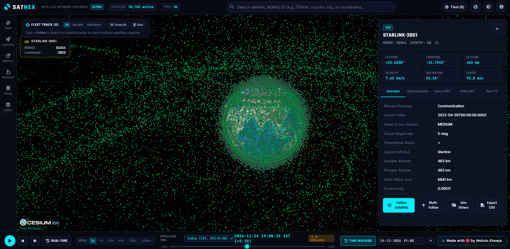

<div align="center">

# 🛰️ SATNEX — Satellite Network Explorer
### Next-Generation 3D Orbital Mechanics & High-Resolution Earth Observation Dashboard

[](https://fastapi.tiangolo.com)
[](https://cesium.com/)
[](https://github.com/thkruz/ootk)
[](https://python.org)
[](#)
[](LICENSE)

<br/>



<br/>

**An aerospace-grade space situational awareness dashboard that combines real-time SGP4 orbital propagation of 50,000+ space objects with true high-resolution composite satellite Earth imagery.**

---

*Designed and Engineered with ❤️ by **Mohsin Khawja***

---

</div>

## 🌌 Why SATNEX?

While traditional trackers rely on low-resolution, flat shaded elevation maps, **SATNEX** brings true Earth observation to orbital mechanics:

- 🌍 **True High-Resolution Earth Imagery:** Real photographic satellite composite (Esri World Imagery) — zoom all the way down to real coastlines, mountain ranges, cities, and spaceports.
- 🗺️ **Crisp Vector Borders & Labels:** Clean geopolitical boundaries and geographic labels.
- 🛰️ **Real-Time 50,000+ SGP4 at 60+ FPS:** Smooth orbital propagation for satellites, rocket bodies, and debris.
- 🚀 **One-Click Country Fleet Trajectories:** Instantly render 3D orbital path webs for an entire nation's fleet.

---

## ⚡ Key Highlights

### 1. High-Fidelity 3D Earth & Ground Features
- **Esri World Imagery:** Real photographic satellite tiles streamed in real time.
- **Cartographic Overlays:** Geopolitical borders, country titles, capital cities, and oceanic trenches.
- **Atmospheric Glow & Lighting:** Authentic solar angle computation, dynamic day/night terminator line, and night city lights.
- **Geographical Search & Spaceport Fly-To:** Search by satellite name, NORAD ID, country, city, spaceport (e.g. *Cape Canaveral*, *Baikonur*, *Satish Dhawan*, *Kourou*), or direct coordinates (`lat, lon`).

### 2. High-Precision SGP4 Orbital Propagation
- **OOTK v8.2.0 Engine:** Industry-standard SGP4/SDP4 mathematical propagator executing on the client side.
- **Authentic KeepTrack Color Taxonomy:**
  - 🟢 **Payloads / Active Satellites:** Emerald Green (`#00ff66`)
  - 🔴 **Rocket Boosters:** Crimson Coral (`#ff3344`)
  - ⚪ **Orbital Debris:** Cosmic Silver (`#cbd5e1`)
  - 🟡 **Space Stations / Crewed:** Amber Gold (`#ffd600`)
- **Distance-Calibrated Dot Scaling:** Uses Cesium `NearFarScalar` to ensure satellites never disappear or turn into blurry blobs when zooming in close to Earth.

### 3. Advanced Fleet Intelligence & Country Trajectories
- **Country Fleet Filtering:** Filter instantly by nation (e.g. United States, India, China, Russia, ESA, Japan, UK).
- **Show All Fleet Orbit Trajectories:** One-click toggle renders the complete 3D orbital path web for all filtered satellites simultaneously with zero lag.
- **Background Fleet Dimming:** Choose between *Show All*, *Dim 90%* (highlight active focus), or *Solo View* (hide all non-tracked objects).
- **Multi-Follow Fleet Dock:** Track multiple satellites concurrently with real-time inter-satellite Euclidean distance and relative velocity ($\Delta v$) readouts.

### 4. Interactive Time Machine
- **Full Orbital Historical Epochs:** Jump backward or forward in time to observe orbital arrangements during historical space milestones or future satellite constellations.
- **Simulation Speed Controls:** Real-time (1x), 5x, 10x, 60x, 300x, and 1000x warp speed.
- **Timeline Scrubber:** Scrub $\pm 24$ hours with millisecond precision.

---

## 🚀 Getting Started

### Prerequisites
- **Python 3.10 or higher** installed on your system.
- Modern web browser (Chrome, Edge, Firefox, Brave) with WebGL enabled.

---

### Step 1: Clone the Repository
```bash
git clone https://github.com/csibmohsin/satnex.git
cd satnex
```

---

### Step 2: Set Up Virtual Environment

**On Windows (PowerShell / Command Prompt):**
```powershell
python -m venv .venv
.venv\Scripts\activate
```

**On macOS / Linux:**
```bash
python3 -m venv .venv
source .venv/bin/activate
```

---

### Step 3: Install Dependencies
```bash
pip install -r requirements.txt
```

---

### Step 4: Configure KeepTrack API Key *(Optional)*

SATNEX includes a pre-packaged curated reference catalog with 300+ operational satellites, meaning **the application runs immediately out of the box without any key!**

To unlock the live 50,000+ full satellite catalog from KeepTrack:

1. Register for an API key at [keeptrack.space/api](https://keeptrack.space/api) or via the KeepTrack user portal.
2. Copy `.env.example` to `.env`:
   ```bash
   cp .env.example .env
   ```
3. Open `.env` in any text editor and paste your key:
   ```env
   KEEPTRACK_API_KEY=your_actual_key_here
   PORT=8000
   CACHE_TTL_SECONDS=3600
   ```

---

### Step 5: Launch SATNEX

**Using Python:**
```bash
python run_dashboard.py
```

**Or on Windows:** Double-click `start.bat`.

Once the server starts, open your browser and navigate to:
```
http://127.0.0.1:8000
```

---

## 🏗️ Architecture & Technology Stack

```
SATNEX/
├── backend/
│   └── server.py           # FastAPI proxy, KeepTrack API V4 gateway & disk cache
├── data/
│   ├── catalog_cache.json  # 1-hour cached catalog (with ETag validation)
│   └── seed_catalog.json   # Curated baseline satellite fleet with real TLEs
├── public/
│   ├── index.html          # Aerospace mission-control interface
│   ├── ootk.bundle.js      # Bundled OOTK v8.2.0 (client-side SGP4 solver)
│   ├── css/
│   │   └── style.css       # Deep-space glassmorphism UI & responsive styling
│   └── js/
│       ├── orbit-engine.js # SGP4 propagation, Keplerian elements & coordinate transforms
│       ├── cesium-manager.js # Cesium 3D Globe, Esri imagery, PointPrimitives & trajectories
│       ├── search-manager.js # Unified search (Satellites, Spaceports, Cities, Coordinates)
│       ├── ui-manager.js   # Drawer menus, telemetry readouts, research tools & modals
│       └── app.js          # Master controller & 60 FPS animation loop
├── run_dashboard.py        # Python entry point
├── start.bat               # Windows one-click launcher
├── requirements.txt        # Python dependency manifest
└── README.md
```

### High-Efficiency Caching Proxy (`backend/server.py`)
- **Single Bulk Request:** Uses `GET /v4/sats/brief` to fetch active satellites in a single call, eliminating aggressive polling.
- **Disk Caching Layer:** Caches catalog responses to disk respecting the API's 1-hour update frequency (`Cache-Control: max-age=3600`).
- **Conditional HTTP (`ETag` / `If-None-Match`):** Sends ETag validation headers to receive lightweight `304 Not Modified` responses, saving bandwidth.
- **Zero Position Polling:** Satellite orbital positions are computed completely client-side in WebAssembly/JS via SGP4 mathematical formulas.

---

## 🛰️ Keyboard & Mouse Controls

- **Left Mouse Drag:** Rotate globe.
- **Right Mouse Drag / Scroll Wheel:** Smooth zoom in/out.
- **Middle Mouse Drag:** Tilt camera / adjust pitch.
- **Left Click Satellite:** Select satellite, display telemetry HUD, and render orbital trajectory.
- **Close Button (X):** Deselect satellite and return globe to free navigation mode.
- **Spacebar / Play-Pause Button:** Toggle orbital simulation playback.

---

## 📄 License

This project is licensed under the MIT License — see the [LICENSE](LICENSE) file for details.

---

## 👨‍🚀 Author & Credits

Engineered and developed with dedication to space science and open web technologies.

- **Author:** Mohsin Khawja
- **Branding:** SATNEX — Satellite Network Explorer
- **Orbital Mechanics Engine:** OOTK (Orbital Object Toolkit) by Theodore Kruczek
- **Geospatial Engine:** CesiumJS
- **Imagery Provider:** Esri World Imagery & CartoDB

<div align="center">
  <sub>Made with ❤️ by Mohsin Khawja</sub>
</div>
